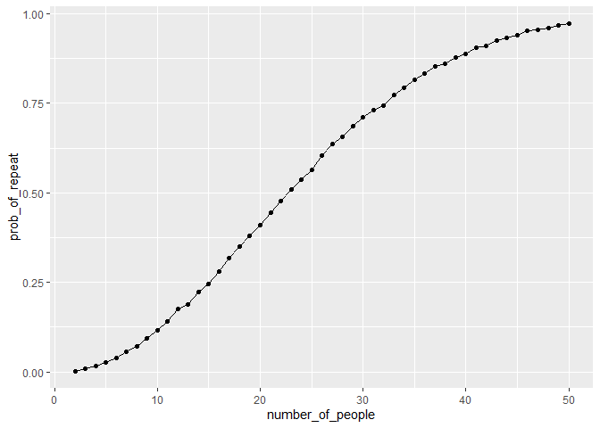
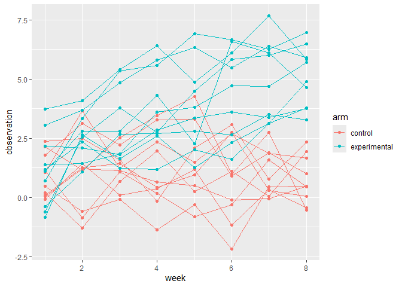
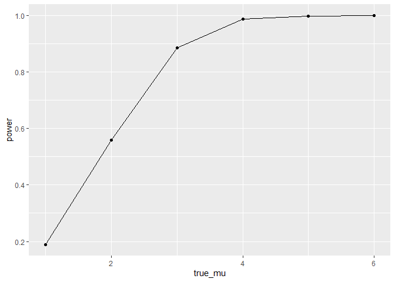
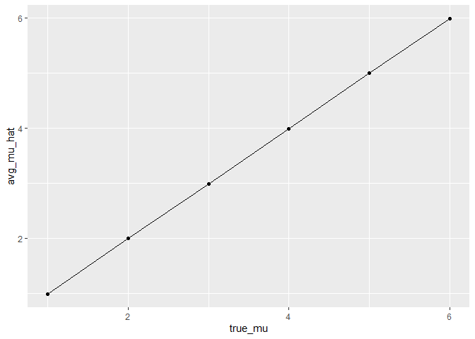
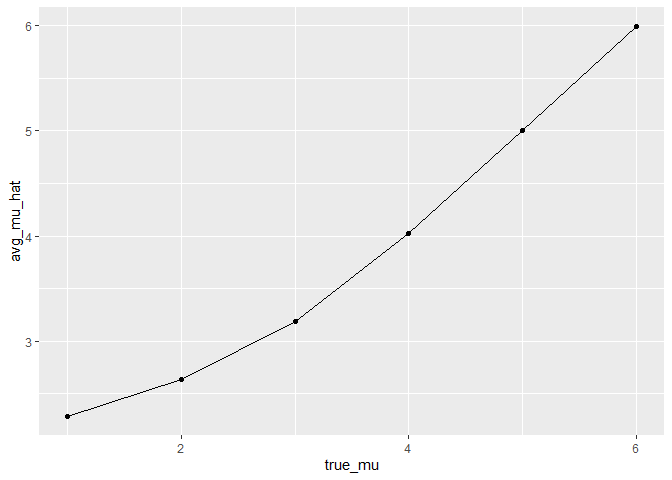

Homework 5
================
Meghan Brown (mmb2355)<br>
2026-11-18

## Problem 1

### Libraries

``` r
library(tidyverse)
```

    ## ── Attaching core tidyverse packages ──────────────────────── tidyverse 2.0.0 ──
    ## ✔ dplyr     1.2.1     ✔ readr     2.2.0
    ## ✔ forcats   1.0.1     ✔ stringr   1.6.0
    ## ✔ ggplot2   4.0.3     ✔ tibble    3.3.1
    ## ✔ lubridate 1.9.5     ✔ tidyr     1.3.2
    ## ✔ purrr     1.2.2     
    ## ── Conflicts ────────────────────────────────────────── tidyverse_conflicts() ──
    ## ✖ dplyr::filter() masks stats::filter()
    ## ✖ dplyr::lag()    masks stats::lag()
    ## ℹ Use the conflicted package (<http://conflicted.r-lib.org/>) to force all conflicts to become errors

``` r
library(rvest)
```

    ## 
    ## Attaching package: 'rvest'
    ## 
    ## The following object is masked from 'package:readr':
    ## 
    ##     guess_encoding

``` r
library(patchwork)

set.seed(127)
```

## Birthdays

``` r
birthday_repeated = function(n) {
  birthdays = sample(1:365, size = n, replace = TRUE)
  length(unique(birthdays)) < n
}

birthday_results_df = 
  expand_grid(
    number_of_people = 2:50,
    iter = 1:10000
  ) |> 
  mutate(
    repeated = map_lgl(number_of_people, birthday_repeated)
  )

birthday_results_df |> 
  group_by(number_of_people) |> 
  summarize(prob_of_repeat = mean(repeated)) |> 
  ggplot(aes(x = number_of_people, y = prob_of_repeat)) +
  geom_point() + 
  geom_line()
```

<!-- -->

## Problem 2

### Combining experimental and control data; tidying data

``` r
long_study_df =
  tibble(
    file_path = c(list.files("data",full.names = TRUE))
  )

subjects_df =
  long_study_df |> 
  mutate(
    filename = basename(file_path),
    subject_id = str_remove(filename, "\\.csv$"),
    arm = if_else(str_starts(filename, "con"), "control", "experimental"),
    data = map(file_path, ~ read_csv(.x, show_col_types = FALSE))
  ) |> 
  unnest(data) |> 
   pivot_longer(
    cols = starts_with("week_"),
    names_to = "week",
    names_prefix = "week_",
    values_to = "observation"
  ) |> 
  mutate(week = as.numeric(week)) |> 
  select(subject_id, arm, week, observation)
```

### Spaghetti plot

``` r
subjects_df |> 
  ggplot(aes(x = week, y = observation, color = arm)) +
  geom_line(aes(group = subject_id)) +
  geom_point()
```

<!-- -->

- The control arm had overall less observations compared to the
  experimental arm The experimental arm observations increased over time
  while the control arm remained relatively level.

## Problem 3

### mu = 0

``` r
mean_sd = function(n = 30, mu = 0, sigma = 5) {
  
  sim_df = 
    tibble(
      x = rnorm(n = n, mean = mu, sd = sigma)
    )
  
  sim_df |> 
    summarize(
      results = list(t.test(x, mu = 0) |> broom::tidy())) |> 
    unnest(results)
}

output = vector("list", length = 5000)

for (i in 1:5000){
   output[[i]] = mean_sd()
}

output |> 
  bind_rows() |> 
  select(estimate, p.value)
```

    ## # A tibble: 5,000 × 2
    ##    estimate p.value
    ##       <dbl>   <dbl>
    ##  1  -1.82    0.0999
    ##  2   1.70    0.147 
    ##  3   1.11    0.264 
    ##  4  -0.589   0.396 
    ##  5  -1.77    0.0329
    ##  6   0.252   0.759 
    ##  7   1.88    0.0497
    ##  8   0.178   0.819 
    ##  9   0.525   0.558 
    ## 10   0.0379  0.968 
    ## # ℹ 4,990 more rows

### mu = 1:6

``` r
all_outputs = vector("list", length = 6)

for (m in 1:6) {
  
  output = vector("list", length = 5000)
  
  for (i in 1:5000) {
    output[[i]] = mean_sd(mu = m)
  }
  
  all_outputs[[m]] = output |> 
    bind_rows() |> 
    select(estimate, p.value) |> 
    mutate(true_mu = m)
}

true_sim_df = bind_rows(all_outputs)
```

### mu vs power

``` r
true_sim_df |> 
  group_by(true_mu) |> 
  summarize(
    power = mean(p.value < 0.05), .groups = "drop"
  ) |> 
  ggplot(aes(x = true_mu, y = power)) +
  geom_point() +
  geom_line()
```

<!-- -->

- effect size: (mu - mu-null/sigma); mu = 1:6, mu-null = 0, sigma = 5
- As effect size increases, it is shifting away from the mu null value
  (0). Because of the shift, the proportion of the times the null was
  rejected - power - increases towards 1.

### mu hat vs true mu and true mu (p \< 0.05)

``` r
mean_est =
  true_sim_df |> 
  group_by(true_mu) |> 
  summarize(
    avg_mu_hat = mean(estimate),
    .groups = "drop"
  ) |> 
  ggplot(aes(x = true_mu, y = avg_mu_hat)) +
  geom_point() + geom_line()

mean_est
```

<!-- -->

``` r
rj_mean_est =
  true_sim_df |> 
  filter(p.value < 0.05) |> 
  group_by(true_mu) |> 
  summarize(
    avg_mu_hat = mean(estimate),
    .groups = "drop"
  ) |> 
  ggplot(aes(x = true_mu, y = avg_mu_hat)) +
  geom_point() + geom_line()

rj_mean_est
```

<!-- -->

- The sample average of mu across tests is not approximately equal
  because the true value of mu depends on effect size and power (which
  is what was shown in mu vs power graph above). As true mu is closer to
  mu null (a smaller true mu) because are more likely to fail to reject
  the null. Those that reject the null (the one shown in the rj_mean_est
  plot) may end up inflating the estimate.
